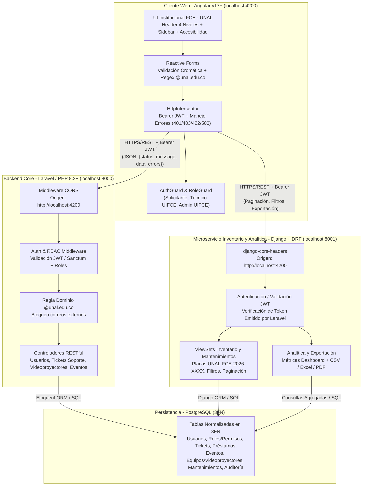

# Arquitectura del Sistema — UIFCE (FCE - UNAL)

## Diagrama de Comunicación HTTP/REST, CORS y JWT

## Reglas Clave de Integración
- **CORS:** Tanto Laravel (`localhost:8000`) como Django (`localhost:8001`) deben habilitar CORS para `http://localhost:4200`, permitiendo `Authorization` y `Content-Type`[cite: 1].
- **JWT compartido:** Laravel autentica cuentas `@unal.edu.co` y emite el token JWT; Angular lo envía en `Authorization: Bearer <token>` a Laravel y a Django, y Django valida el token y el rol del usuario[cite: 1].